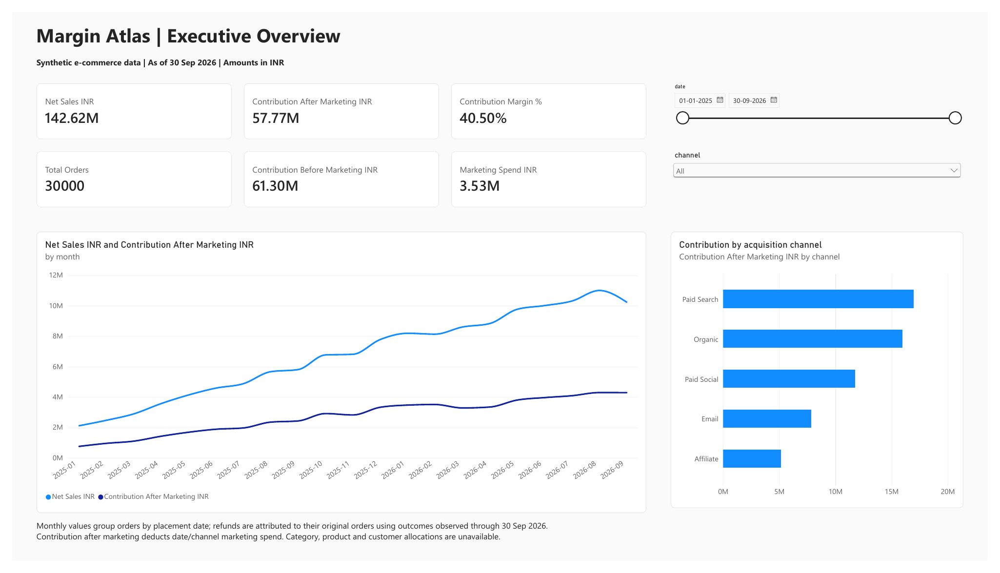
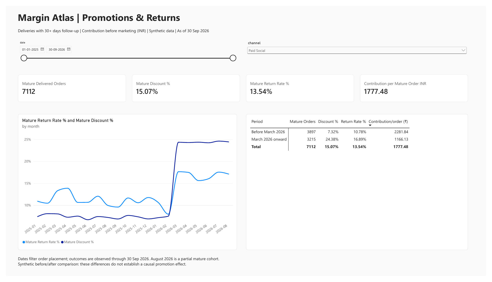
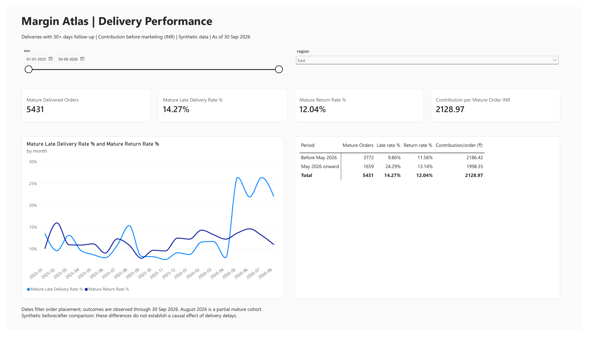
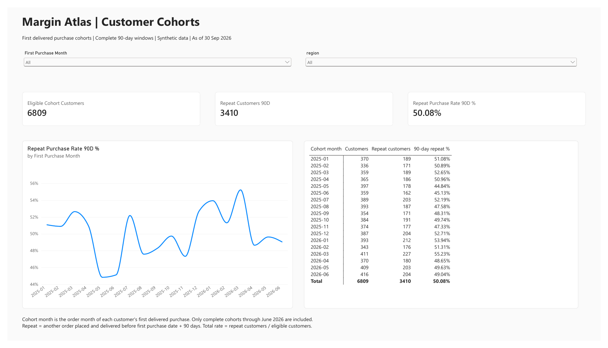

# Margin Atlas

An e-commerce analytics project investigating how discounts,
returns, fulfilment costs, and marketing affect contribution.
## Report previews

[View the four-page PDF](docs/Margin%20Atlas.pdf) |
[Download the Power BI report](Margin%20Atlas.pbix)

### Executive Overview


### Promotions & Returns
Paid Social case study.


### Delivery Performance
East-region case study.


### Customer Cohorts
All eligible cohorts and regions.

## Tools
MySQL, Python, Power BI, and GitHub.

## Data
Synthetic demonstration data generated with Python.

## Data pipeline and validation
- Created and populated all eight MySQL tables.
- Generated, validated, and loaded 60 products and 8,000 customers.
- Logged 20 duplicate customer rows and repaired 30 missing regions.
- Loaded 30,000 orders and 60,209 product lines.
- Reconciled each order's gross amount, discount, and product cost.
- Updated customer first-purchase dates from delivered orders.
- Loaded 3,190 daily marketing records across five channels.
- Verified zero reconciliation issues in the final database checks.

## Simulation notes
- All data, budgets, costs, and business scenarios are synthetic.
- The reporting snapshot is 30 September 2026.
- Higher Paid Social promotions and East-region delivery delays
  were deliberately introduced for analytical practice.
 ## Power BI report
- Built an interactive Overview page in Margin Atlas.pbix.
- Added six KPI cards, a monthly trend, and a channel comparison.
- Added date-range and acquisition-channel slicers.
- Validated date and channel filters against source-data totals.
- Marketing spend is analyzed at date and acquisition-channel level.
## Promotions & Returns
- Added four KPIs, monthly discount and return trends, and a before/after comparison.
- Included only delivered orders with at least 30 days of follow-up.
- Validated Paid Social results against SQL: return rate rose from 10.78% to 16.89%, while contribution before marketing per mature order fell from INR 2,281.84 to INR 1,166.13.
- Documented the fixed snapshot, partial latest cohort, and limitations of causal interpretation.
## Delivery Performance
- Added date and region filters, four mature-order KPIs, a monthly trend, and a before/after comparison.
- Validated East-region results against SQL: late delivery rate rose from 9.86% to 24.29%, and return rate rose from 11.56% to 13.14%.
- Contribution before marketing per mature order fell from INR 2,186.42 to INR 1,998.35.
- Documented the observation window and limitations of causal interpretation.
## Customer Cohorts
- Analyzed 18 first-purchase cohorts from January 2025 through June 2026, requiring a complete 90-day observation window for each cohort.
- Counted customers with another order placed and delivered within 90 days of their first delivered purchase.
- Validated 6,809 eligible customers and 3,410 repeat customers: an overall repeat purchase rate of 50.08%, calculated from customer counts.
- Verified the June 2026 filter: 416 customers, 204 repeat customers, and a 49.04% repeat rate.

## Using the report

- Open the PDF or preview images for a static overview.
- Open `Margin Atlas.pbix` in Power BI Desktop for interactive filtering. The imported data is already included in the report.
- Before refreshing on another computer, update the eight CSV queries' local source paths to that computer's `data/powerbi` folder.
- The saved Promotions & Returns page highlights Paid Social; Delivery Performance highlights East. Clear those slicers to explore other groups.
- Customer Cohorts uses first-purchase month and region filters. Its page filter includes only eligible 90-day cohorts.

## Metric definitions

| Metric | Definition |
|---|---|
| Net sales | Gross sales minus discounts and refunds |
| Net product cost | Product cost minus recovered inventory value |
| Contribution before marketing | Net sales minus net product cost, fulfilment, payment fees, and reverse logistics |
| Contribution after marketing | Contribution before marketing minus marketing spend |
| Contribution margin | Contribution after marketing divided by net sales |
| Mature delivered orders | Delivered orders with at least 30 days of follow-up by the snapshot |
| Mature discount rate | Total discounts divided by total gross sales within mature delivered orders |
| Mature return rate | Returned mature orders divided by mature delivered orders |
| Contribution per mature order | Contribution before marketing within mature delivered orders divided by their count |
| 90-day repeat purchase rate | Eligible customers with a qualifying repeat order divided by all eligible customers |

A qualifying repeat order must be another delivered order, placed on or after the first-purchase date and both placed and delivered before that date plus 90 days. An entire first-purchase month must have a complete observation window.

## Scope and limitations

- All data and business scenarios are synthetic. Before/after differences are descriptive and do not establish causal effects or realized business improvements.
- The fixed reporting snapshot is 30 September 2026.
- Financial trends group orders by placement date. Refunds are assigned to their original orders using outcomes observed by the snapshot.
- Contribution excludes overhead, taxes, and other unmodeled costs.
- Marketing spend exists only at date and acquisition-channel level. Marketing-dependent measures return blank under unsupported category, product, or customer filters.
- Acquisition channel represents the customer's original source, including repeat orders.
- Each order contains one category. Product-level refunds and shared costs have not been allocated.
- Recent order cohorts have incomplete return observation. The mature-order pages include a partial August 2026 cohort.
- Cohort totals use combined customer counts. Eligible first-purchase months run from January 2025 through June 2026.

## Reproducing the project

### Environment

The project was developed with Python 3.15.2, local MySQL, MySQL Workbench, and Power BI Desktop on Windows. Python dependencies are pinned in `requirements.txt`.

Run terminal commands from the repository root:

```powershell
python -m venv .venv
.\.venv\Scripts\python.exe -m pip install -r requirements.txt
```

### Database access

Python connects to `127.0.0.1:3306`, database `margin_atlas`, using the local account `margin_atlas_app`.

Create that account with SELECT, INSERT, UPDATE, and DELETE privileges on the project database. Run schema changes and view creation through a MySQL administrator account.

Scripts prompt for the application account's password using `getpass`.

### Fresh database build order

Use this sequence for a fresh project database. Loaders require empty target tables.

| Step | Files to run in numeric order |
|---|---|
| 1 | SQL files `01_` through `11_`: database, dimensions, facts, and schema additions |
| 2 | Python `01_test_mysql_connection.py`: verify application access |
| 3 | Python files `02_` through `08_`: products and customers; then SQL `12_` and `13_` for verification |
| 4 | Python files `09_` through `20_`: orders, items, financials, validation, and marketing |
| 5 | SQL files `14_` through `17_`: customer first-purchase dates, database checks, and economics views |
| 6 | Python `21_export_powerbi_data.py`: export the eight Power BI CSV files |
| 7 | SQL files `18_` through `21_`: channel, promotion, delivery, and repeat-purchase analyses |

Run each Python file individually. For example:

```powershell
.\.venv\Scripts\python.exe python\01_test_mysql_connection.py
```

The Power BI export reads all eight datasets from one consistent MySQL snapshot and checks expected row counts before writing files. Its `fact_orders.csv` includes derived financial columns from `vw_order_economics`.

To refresh the report, update its CSV source paths to the local `data/powerbi` folder and refresh in Power BI Desktop.

### Repository structure

- `sql/`: schema, verification queries, views, and analyses.
- `python/`: numbered generation, cleaning, validation, loading, and export scripts.
- `data/raw/`: generated synthetic source files.
- `data/processed/`: cleaned and validated data.
- `data/audit/`: validation results and cleaning logs.
- `data/powerbi/`: eight exported reporting datasets.
- `docs/`: report PDF and preview images.
- `Margin Atlas.pbix`: interactive four-page report.