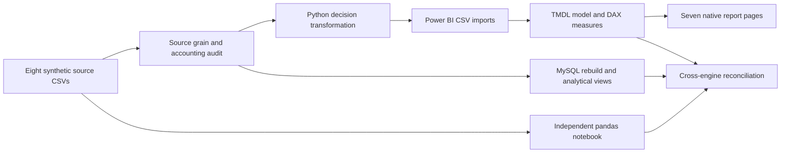

# Architecture and analytical decisions

Orders are the authoritative economic grain; 60,209 item rows reconcile to them. The order snapshot has one category per order, which limits product-mix realism. Money remains integer paise until report presentation. Region can be Unknown; it is retained rather than silently excluded.

The Power BI model relates FactOrders to date, category, channel, customer and an exclusive category-region segment dimension. Marketing relates only to date/channel. Cohorts relate to customers and use their own first-purchase cohort field; an order-month filter cannot redefine the original acquisition cohort.

The decision partition has 30 non-overlapping segments. The fixed CSV summary is an audit output, not a slicer-responsive score. Report measures recalculate exposure, sample eligibility and rank under the active context. A report-wide scalar rank is blank because it has no meaningful single-segment interpretation.

Recovery, intervention cost, sample threshold and metric controls are disconnected tables. The sensitivity curve uses another disconnected table so the selected recovery point cannot filter its complete 0–40% axis.

No observational return/delivery association is treated as a causal intervention effect. A diagnostic queue indicates where to investigate, while the scenario shows assumptions required for a business case. The two outputs answer different questions.
